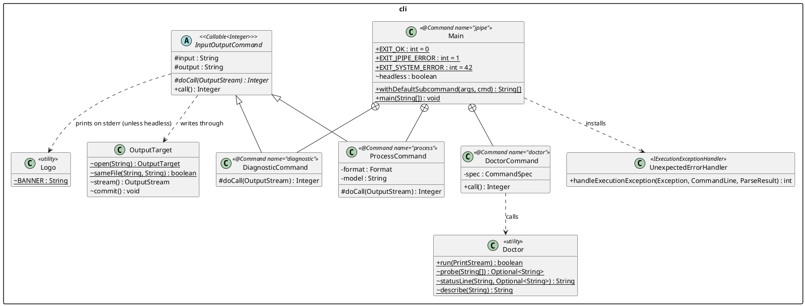

# CLI

The `jpipe-cli` module is the public entry point for jPipe. It exposes a
PicoCLI command hierarchy and assembles pipelines via `CompilerFactory`.

## Command hierarchy



## Commands

### `process` (default)

Compiles a `.jd` source file and exports the selected model in the requested
format. This is the default subcommand: invoking `jpipe` without a subcommand
name is equivalent to `jpipe process`.

```
jpipe process -i <file> -m <model> [-f <format>] [-o <output>]
```

| Option | Short | Required | Default | Description |
|--------|-------|:--------:|---------|-------------|
| `--input` | `-i` | No | stdin | Input `.jd` source file |
| `--output` | `-o` | No | stdout | Output file |
| `--model` | `-m` | **Yes** | — | Name of the model to export |
| `--format` | `-f` | No | `JPIPE` | Output format (see table below) |

Delegates to `CompilerFactory.build(config, out)`. Returns exit code `0` on
success, `1` if any ERROR or FATAL diagnostic was reported.

**Output formats**

| Value | Description | Requires Graphviz |
|-------|-------------|:-----------------:|
| `JPIPE` | jPipe source that compiles back to the same model (see below) | No |
| `DOT` | Graphviz DOT source | No |
| `PNG` | Rendered PNG image | Yes |
| `JPEG` | Rendered JPEG image | Yes |
| `SVG` | Rendered SVG image | Yes |
| `JSON` | JSON model dump | No |
| `PYTHON` | Step-library skeleton for [jpipe-runner](https://github.com/jpipe-mcscert/jpipe-runner) 4 | No |

**The `JPIPE` format** is a round-trip: compiling the output gives back the
model exported, with the same elements, ids, relations and aliases. The output
is self-contained, and never holds a `load`:

- the model comes after every model it depends on, each written once: the
  template it implements, that template's own ancestors, and the models it was
  composed from;
- a model that implements a template declares only what its source did: its
  own elements, the `@support`s it overrides, and its own relations;
- a model built by an operator is written as the operator call that built it,
  so its ids are the ones the operator gives them again;
- a model loaded under a namespace is inlined under a plain name, since a
  model name cannot hold a `:`: `base:t` becomes `base_t` (followed by `_2`,
  `_3`… if that name is taken), and every id that names it changes with it,
  `base:t:abs` becoming `base_t:abs`.

Comments and the layout of the original source are not kept.

**The `JSON` format** describes one model. jpipe-runner reads it to run a
justification and to draw it.

```jsonc
{
  "name": "readiness",
  "type": "justification",            // or "template"
  "elements": [
    { "type": "sub-conclusion",       // "conclusion", "sub-conclusion", "strategy",
                                      // "evidence" or "abstract-support"
      "id": "readiness:hook",         // qualified with the model's name
      "label": "The code is tested",
      "aliases": [ "readiness:draft:tests", "readiness:tested:tested" ],
      "origins": [ { "model": "draft",  "id": "draft:tests",   "type": "evidence" },
                   { "model": "tested", "id": "tested:tested", "type": "conclusion" } ] }
  ],
  "relations": [ { "source": "readiness:draft:s", "target": "readiness:c" } ]
}
```

- `elements` lists the model's elements once it is built, inherited ones
  included, and `relations` its support edges, from the supporting element to
  the supported one.
- `aliases`, on an element that composition or unification merged, lists the
  ids it was merged from, at every level, qualified like `id`.
- `origins`, on an element of a model built by an operator, lists the
  elements of the models it was composed from that it was built from, at every
  level, nearest first, each once. An element a model inherits from a template
  built by an operator has the origins it has in that template. Each gives its model, its id as that model's own JSON
  export writes it, and its kind there. An element whose kind composition
  changed says what it was: the hook `refine` merges into a sub-conclusion, or
  the conclusion of a source that `assemble` turns into a sub-conclusion. An
  element the operator creates itself, such as `assemble`'s conclusion, has
  none.

`aliases` and `origins` are left out when they would be empty, so the JSON of
a model that no operator built, and that implements no template an operator
built, has neither.

A model that implements a template also gets an `implements` object, with
everything the `DOT` export draws for the template chain, so that the diagram
can be rebuilt from the JSON alone. The model below implements `intermediate`,
which implements `root` and fills its `@support abs1`:

```jsonc
"implements": {
  "elements": [ "leaf:intermediate:abs_i", "leaf:root:abs2" ],
  "templates": [
    { "name": "intermediate",
      "elements": [ "leaf:intermediate:s", "leaf:intermediate:abs_i", "leaf:root:abs1" ],
      "placeholders": [ { "id": "leaf:intermediate:abs_i",
                          "label": "An intermediate abstract support",
                          "supports": [ "leaf:intermediate:s" ] } ] },
    { "name": "root",
      "elements": [ "leaf:root:c", "leaf:root:s", "leaf:root:abs1", "leaf:root:abs2" ],
      "placeholders": [ … ] }
  ]
}
```

- `elements` lists the elements drawn outside every template, in drawing
  order: the model's own, then the `@support`s it fills.
- `templates` lists the template chain, the template the model implements
  first. Each template is drawn as a cluster labelled `<<template>> name`,
  inside the cluster of the one before it, and lists the ids drawn in it, in
  drawing order: its own elements, then the `@support`s it fills further up.
- A placeholder is a template's `@support` that is filled further down the
  chain. Its id is in its template's `elements`, where it is drawn with its own
  `label`, and it is filled by the element with the same id, drawn where that
  element's own template (or the model) draws it. The diagram links the two.
- `supports` lists the strategies whose edge from that id, in `relations`, is
  drawn from the placeholder rather than from the element that fills it: the
  edge belongs to the template.

Placeholders are never in `elements`, whose types stay `conclusion`,
`sub-conclusion`, `strategy` and `evidence` for a justification. The JSON of a
model that implements no template has no `implements` key.

### `diagnostic`

Parses and validates a `.jd` source file and reports on it without exporting
any model. Useful for checking a file for errors, inspecting the symbol table,
or feeding an IDE.

```
jpipe diagnostic -i <file> [-o <output>] [-f <format>]
```

| Option | Values | Default |
|--------|--------|---------|
| `-f`, `--format` | `TEXT`, `JSON` (case-insensitive) | `TEXT` |

The report has five sections:

1. **Diagnostics** — all ERROR and FATAL messages, with source locations and
   their diagnostic code.
2. **Action Statistics** — total command count, macro count, and deferral
   count from the `ExecutionEngine`.
3. **Model Summary** — for each model: kind (justification/template), parent
   template (if any), element counts, and which justifications implement it.
4. **Symbol Table** — all element ids with their source locations, plus alias
   mappings from composition operators.
5. **Executed Actions** — the ordered model-construction command trace.

Sections whose data is absent (no statistics recorded, no actions executed)
are omitted rather than printed empty.

Both formats are produced from the same `DiagnosticSnapshot`, collected once by
`CollectDiagnostics` and then rendered by either `DiagnosticReport` (text) or
`JsonDiagnosticReport` (JSON), so the two can never describe different
compilations. Delegates to
`CompilerFactory.buildDiagnosticCompiler(format, out)`.

#### JSON report

```jsonc
{
  "schemaVersion": 1,
  "source": "examples/foo.jd",
  "status": "ok",                    // "ok" | "errors"
  "diagnostics": [
    { "severity": "error",           // "error" | "fatal"
      "code": "unknown-model",       // omitted when the diagnostic has no code
      "source": "foo.jd",
      "line": 12, "column": 4,       // both omitted when the location is unknown
      "message": "unknown model 'bar'" }
  ],
  "stats": { "commands": { "total": 42, "macros": 3 }, "deferrals": 1 },
  "models": [
    { "name": "m", "kind": "justification",
      "implements": "t",             // omitted when the model implements nothing
      "location": { "source": "foo.jd", "line": 3, "column": 0 },
      "elements": { "conclusion": 1, "subConclusion": 2, "strategy": 1,
                    "evidence": 3, "abstractSupport": 0 },
      "usedBy":  [ { "name": "j", "location": { … } } ],  // templates only
      "symbols": [ { "id": "e1", "kind": "evidence",
                     "synthesized": false, "location": { … } } ],
      "aliases": [ { "from": "a", "to": "b" } ] }
  ],
  "actions": [ { "index": 1, "depth": 0, "macro": false, "description": "…" } ]
}
```

Optional keys are omitted rather than emitted as `null`. Arrays preserve order;
object key order is not significant. `schemaVersion` is incremented whenever the
set of members changes, additions included — the schema is strict, so no change
is invisible to a consumer validating against it.

The document is described by a published **[JSON Schema](diagnostic-schema.md)**
that acts as the contract with consumers; it ships on the classpath at
`/schema/diagnostic-report-v1.schema.json` and every report the test suite
produces is validated against it.

The ASCII logo goes to standard error, so it never corrupts a report or an
export written to standard output. It is also left out when the JSON report
goes to standard output, since that is how tools call the command. Writing to a
file with `-o` keeps it.

**Reporting on a compilation that aborted.** A *fatal* error — a syntax error,
an unresolvable `load` — stops the pipeline, but the report is still written in
both formats: the diagnostics describe the failure, `models` is empty and the
symbol table reads `(empty)`, because nothing could be built. The exit code is
1. Consumers detect the case by finding a diagnostic with `severity: "fatal"`,
and need no separate path for it.

A source file that cannot be read at all, whether it cannot be opened or fails
while being read, is reported the same way, as a fatal diagnostic with exit
code 1, rather than as the system error (42) it remains under `process`. A
compilation that stopped is never reported as `ok`: a step that aborted without
recording why still leaves a fatal in the report.

This is why `diagnostic` has its own compiler rather than assembling the report
as the tail of the analysis chain — a report produced as a pipeline step could
never describe the failures that stopped that pipeline. `process` deliberately
keeps the old behaviour: its output stream carries a model export, so a report
poured into it would corrupt the artefact. A fatal there still reaches standard
error with exit code 1 and no output.

### `doctor`

Checks that external tools required by jPipe are available on `PATH` and
prints a status line for each. Also prints the jPipe version number.

```
jpipe doctor
```

```
  dot (Graphviz): OK (version 12.2.1)
```

Currently checks: `dot` (Graphviz). A tool is considered available if the OS
can launch the executable; the exit code of the probe is ignored. The probe
output is scanned for a version number, which is reported next to the status —
several operating systems ship an outdated Graphviz, and that shows up as
rendering bugs. When no version can be read out of the banner, the status line
reads `OK (version unknown)`. Returns exit code `0` if all tools are found, `1`
otherwise.

## Shared infrastructure

### `InputOutputCommand`

Abstract base for `ProcessCommand` and `DiagnosticCommand`. Handles:

- **Logo display** — prints `Logo.BANNER` on standard error, unless
  `--headless` is set. `doctor` does the same.
- **Output stream resolution** — through an `OutputTarget`. Standard output is
  used as is. A file given with `-o` is not opened while the command runs: the
  output is held in memory and written to the file, in place, once the command
  has produced it. A run that aborts (a fatal error, an unknown model, a failed
  render) leaves the previous file as it was; a run that reports non-fatal
  errors still writes its export, as ADR-0016 requires. Writing in place keeps
  what the target is — `/dev/null`, a pipe, a symbolic or hard link, a file's
  owner and permissions. A target that is a directory, is read-only, or would be
  created in a missing or read-only directory is refused before compiling, as
  `error: cannot write '<path>': <reason>`.
- **Same input and output** — an `-o` that names the input file is refused with
  exit code `2` before anything runs, since the export (or the report) would
  replace the source.
- **Error reporting** — catches `CompilationException` and
  `UnsupportedOperationException` and prints a clean `error: …` message to
  stderr, with exit code `1`. An output that cannot be written, and a source
  that cannot be read under `process`, print `error: …` naming the file, with
  exit code `42`.

Subclasses implement `doCall(OutputStream)` and receive the resolved output
stream.

### `Doctor`

Package-private utility that probes each required external tool by attempting
`ProcessBuilder` launch. Tools are configured in a static `LinkedHashMap` so
that new dependencies can be added without changing `DoctorCommand`.

### `UnexpectedErrorHandler`

Installed on the root `CommandLine` by `Main.commandLine()`, so it covers every
subcommand. Any exception a command did not handle — a bug, or a failure outside
the compiler's control — is reported as one `internal error: …` line on stderr,
with a pointer to the issue tracker, and exit code `42`. The stack trace is
logged at `DEBUG`, so `--log-level DEBUG` shows it. Without the handler, picocli
would print the trace and exit `1`, which reads as an ordinary compilation
error.

### Default subcommand

PicoCLI 4.x has no built-in default-subcommand API. `Main.withDefaultSubcommand()`
pre-processes the argument array. It skips the parent-level flags, in either the
`--log-level INFO` or the `--log-level=INFO` form, and looks at the token right
after them: a subcommand name, `--help` or `--version` leaves the arguments
unchanged; anything else gets `"process"` inserted in front of it. Only that
position counts, so `jpipe -i doc.jd -m doctor` exports a model named `doctor`.
Subcommand names and parent flag arities are derived from the live
`CommandLine` object at call time, so the method stays correct when the command
tree changes.

### Global options

| Option | Description |
|--------|-------------|
| `--headless` | Do not print the logo. |
| `--log-level LEVEL` | Verbosity of the compiler's trace on stderr: `OFF`, `ERROR` (default), `WARN`, `INFO`, `DEBUG`, `TRACE`, case-insensitive. Any other value is rejected. |
| `-h`, `--help` / `-V`, `--version` | On the root command and on every subcommand. |

**Diagnostics are not logs.** The diagnostics of a `process` run are printed on
stderr as `file:line:column: severity: [code] message` lines, on picocli's error
writer: `ProcessCommand` builds its compiler with
`CompilerFactory.build(config, out, diagnostics)`. No logger is involved, so no
level hides a compilation error.

**The logging back end follows the level.** Before picocli runs,
`LoggingBootstrap` reads `--log-level` from the parent flags. At `OFF` or
`ERROR`, the default, the run uses the simple logger built into the Log4j API,
so log4j-core and `log4j2.xml` never start: at that level the compiler has
nothing to log, and starting them was a large share of a call's start-up time
(#216). `WARN` and above start log4j-core with `log4j2.xml`, and `setLogLevel`
tunes the `ca.mcscert.jpipe` logger through its `Configurator`. Log4j also
starts as before when the user configured it (any `log4j` or
`org.apache.logging.log4j` system property, or `LOG4J_` environment variable),
and when an `@file` argument may hold
`--log-level`, since picocli expands it only after Log4j has started.

## Exit codes

| Code | Constant | Meaning |
|------|----------|---------|
| `0` | `EXIT_OK` | Success |
| `1` | `EXIT_JPIPE_ERROR` | Compilation error or missing tool |
| `2` | `CommandLine.ExitCode.USAGE` | Invalid command line: unknown option, invalid value (picocli), or an output that is the input file |
| `42` | `EXIT_SYSTEM_ERROR` | System error: a source that cannot be read (under `process`), an output that cannot be written, or an unexpected exception |
