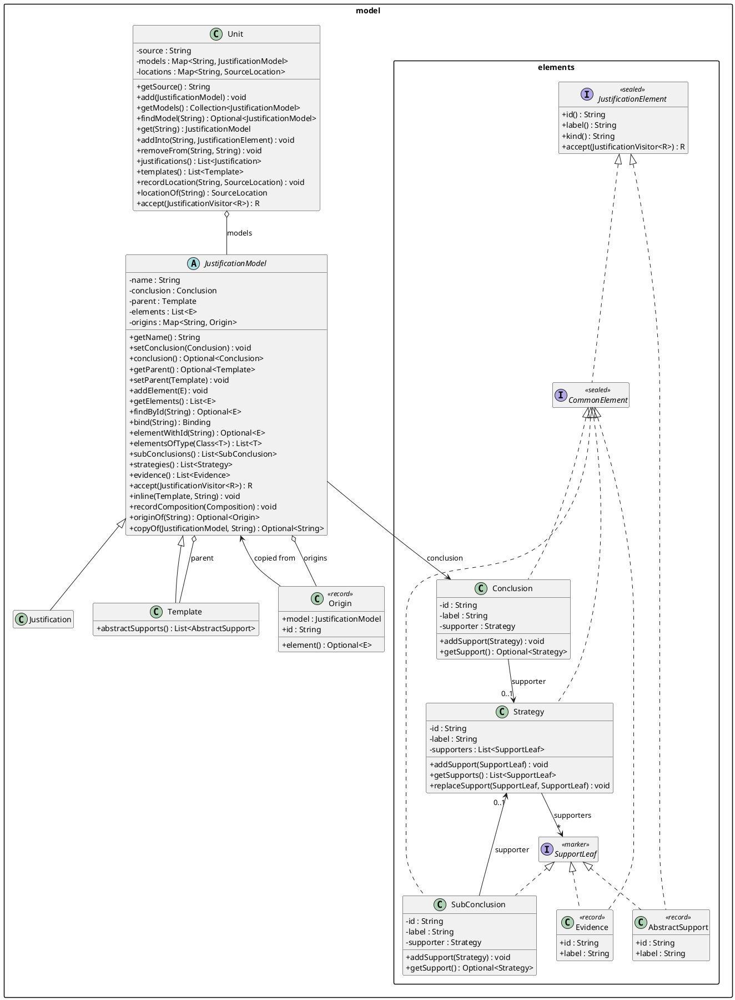
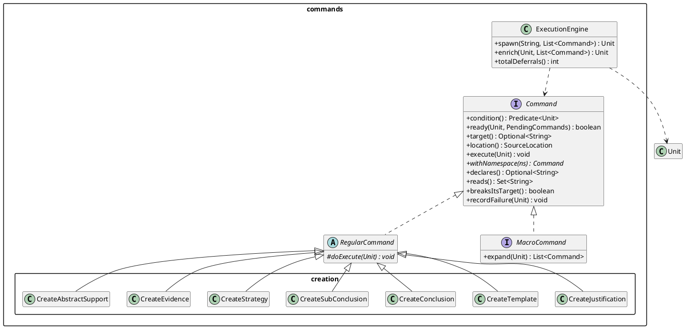
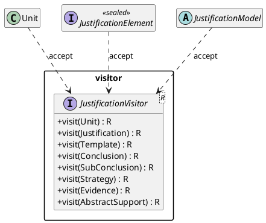

# Model

The `jpipe-model` module defines the internal representation of a compiled jPipe
file. It is structured around four packages.

## Packages

### `model.elements` and `model`

The element hierarchy is rooted at the sealed interface `JustificationElement`.
Elements that appear in both justifications and templates implement `CommonElement`;
`AbstractSupport` is template-only.

Support relationships are encoded directly via typed fields and one marker interface:

- **`SupportLeaf`** — marker for elements that can act as direct supporters of a strategy
  (`SubConclusion`, `Evidence`, `AbstractSupport`).
- `Conclusion` and `SubConclusion` each hold a single `supporter : Strategy`. Cardinality is enforced via `addSupport` which prevents multiple assignments.
- `Strategy` holds a list of supporters (`List<SupportLeaf>`). Multiple elements can support a single strategy (e.g., shared evidence or convergence).

`JustificationModel` is the sealed base for `Justification` and `Template`,
both of which hold any `JustificationElement`. A justification only *declares*
`CommonElement`s (`Unit.addInto` refuses an `AbstractSupport`), but implementing
a template copies the template's `AbstractSupport` placeholders into it until
they are overridden; one left over is reported by `no-abstract-support`. A
`Unit` is the root produced by compiling one `.jd` file.

A model records where each copied id comes from, when the copy is made
(`Origin`, ADR-0012): `inline` records one per element of the template it
copies, and `recordComposition` one per `source:id` the operator copied, each
element and each alias of each source. What a model owns, inherits or
overrides, the id it gives its copy of an ancestor's element (`copyOf`), and
which models an id names are looked up there, never parsed from the id.

### `commands` / `commands.creation`

Model construction uses the Command pattern. `RegularCommand` is the base for all
concrete commands. The `ExecutionEngine` handles deferred execution (commands that
are not ready yet), macro expansion, and deadlock detection. A command is ready
when its `condition()` holds and, for `ImplementsTemplate`, `AddSupport` and
`ApplyOperator`, when no pending command still targets the model it depends on
(`ready(Unit, PendingCommands)`, `target()`): `ImplementsTemplate` and
`ApplyOperator` wait until the models they `reads()` are settled
(`PendingCommands.settled`). A command declares whether its failure leaves
its target unusable (`breaksItsTarget()`: an `implements`, an operator call),
and records what its failure leaves behind (`recordFailure(Unit)`). The target
of such a command that failed or never ran, a model whose `implements` did not
apply or the result of an operator call, is so marked incomplete on the `Unit`
(`markIncomplete`): nothing consumes it, and the validators skip it, since its
gaps follow from a failure already reported. An override that fails records
the placeholders it leaves (`recordFailedOverride`).

### `visitor`

`JustificationVisitor<R>` provides a typed traversal over the full element
hierarchy. All model nodes implement `accept`.

